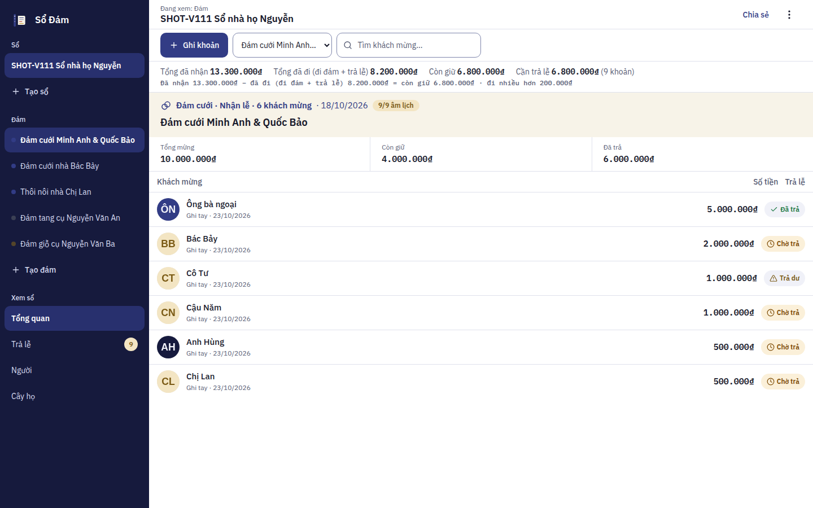
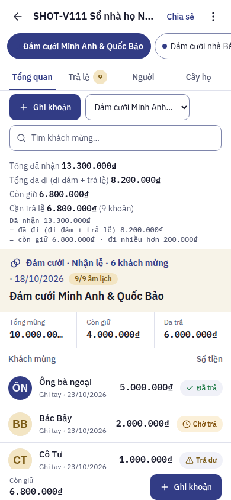
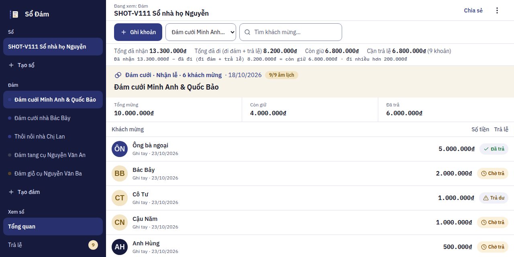
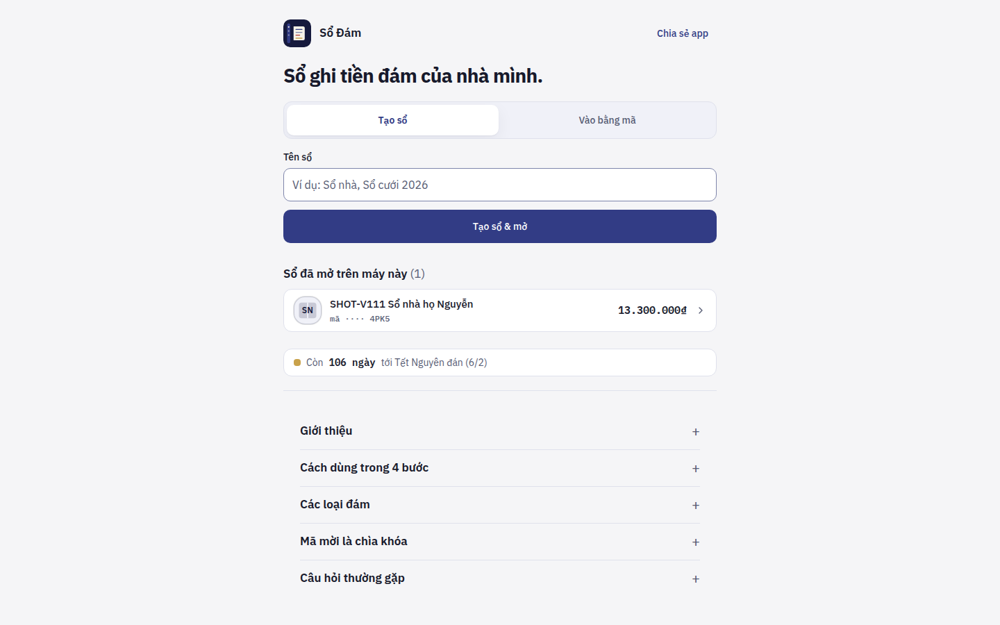
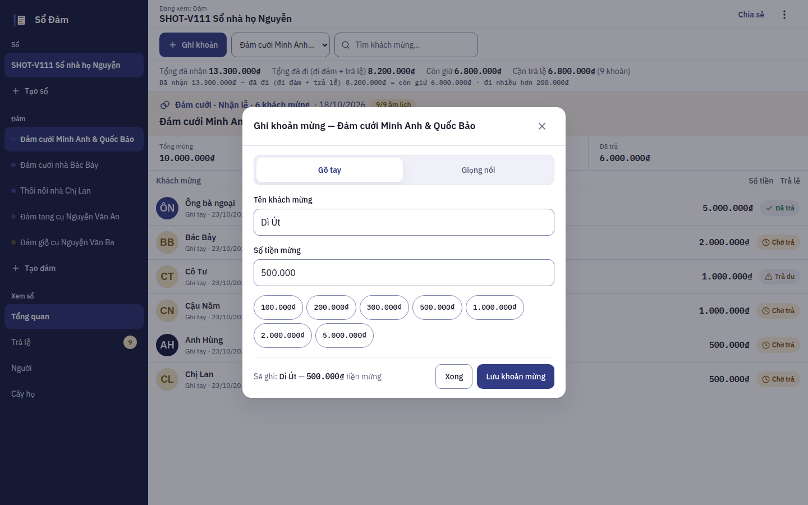
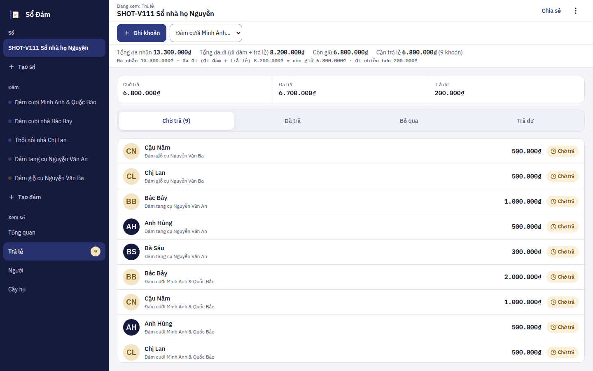
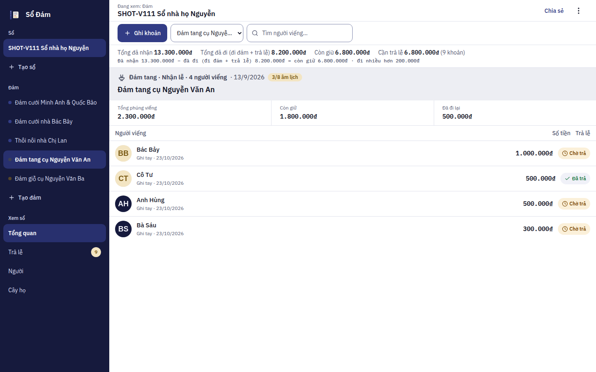
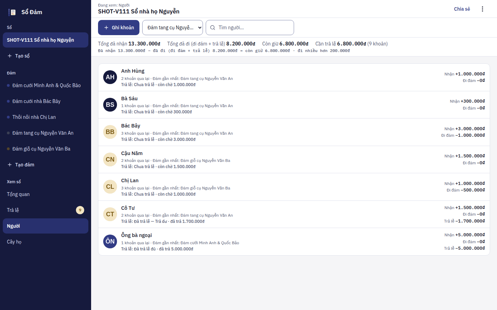

<p align="center">
  
</p>

# Sổ Đám (sodam)

> Receive gifts, return favors, remember who — speak it like a village ledger.
>
> Nhận lễ, trả lễ, với ai — nói như sổ dưới quê.

[](https://sodam-tawny.vercel.app)
[](LICENSE)

**🔴 Live: https://sodam-tawny.vercel.app** — no account, no sign-in: open the app
and create your first book. Each book is protected by its own invite code; share the
code (or the share link) with family so everyone writes in the same book.
Repository: https://github.com/changvn2002/sodam

<p align="center">
  
</p>
<p align="center"><em>The live wedding workspace of a real family book — every guest row carries its return state, the totals strip spells out its own formula, and there is no sign-in anywhere.</em></p>

**Tóm tắt (Tiếng Việt):** Sổ Đám là sổ ghi lễ cho các đám của người Việt — cưới, đám hỏi,
đám tang, giỗ, mừng thọ, tân gia… Ghi ai đã mừng bao nhiêu bằng tay hoặc bằng giọng nói;
app tự theo dõi nghĩa vụ trả lễ, cho cả nhà dùng chung một cuốn sổ bằng
mã mời và vẽ cây họ. Dữ liệu nằm trong database PostgreSQL của chính bạn.

**Sổ Đám** is a Vietnamese gift-ledger app for ceremonies — weddings (cưới), engagements
(đám hỏi), funerals (đám tang/ma), death anniversaries (giỗ), longevity celebrations
(mừng thọ), housewarmings (tân gia), birthdays and more. It records who gave what at
events you host, tracks what you owe back ("trả lễ"), and keeps a people/family-relation
graph per book.

This is the **standalone, self-contained** extraction of Sổ Đám: a single Next.js
full-stack app (UI + API routes + database) that anyone can clone, run and develop
further. It was extracted from the Changtotech studio monorepo, where the same product
ran as a client module talking to a NestJS backend.

## ✨ Features

- **Multiple books (sổ)** with **no account at all**: open the app and start. Each book is protected by a high-entropy invite code (16 characters, ≈79 bits, generated server-side with rejection sampling over `crypto.randomBytes` and stored only as a hash); share the code or the one-tap share link and family members open the book directly and write together. Books you created or joined are remembered on each device (local storage) — there is no login anywhere.
- **Events** across 13 Vietnamese ceremony kinds, hosted or attended, with per-event totals, settled amounts and net balances.
- **Entries (lễ)** recorded manually, in batch, or by voice (speech → AI parse of Vietnamese gift lines like *"anh Tuấn 500 nghìn"*). Photo extraction from a handwritten ledger exists in the codebase but is **off in the public deployment** — it only activates when the server is configured with an AI key, and the entry point is hidden until then.
- **Return obligations (trả lễ)** generated automatically when guests give at your hosted events; mark them done/skipped and see over-given amounts.
- **People directory** with gift history search, plus a **family tree** built from relations (spouse / parent / child / sibling / other).
- **Dashboard totals**: received, settled, pending returns, over-given, given.
- **CSV export/import** of a book's ledger.
- **Offline outbox (partial offline, stated precisely)**: a hand-written service worker precaches the app shell, but book data lives on the server — opening a book needs a connection and the app does **not** work fully offline. If the connection drops while the app is open, new entries you record are queued in an on-device outbox (IndexedDB) and synced automatically when you are back online (entry creations only — see *Known limitations*).
- **Lunar calendar** display for event dates (Vietnamese âm lịch).

## 🖼️ Screenshots

Every screenshot below was captured from the live production deployment at
https://sodam-tawny.vercel.app (the redesign-v2 "Command Ledger" build,
v1.1.1) with the app in a **real, populated state** — never an empty first-run
screen. The book on screen is **"Sổ nhà họ Nguyễn"** (capture copy
"SHOT-V111"), holding five events: a hosted wedding ("Đám cưới Minh Anh &
Quốc Bảo", 18 Oct 2026) with six guests, a hosted funeral ("Đám tang cụ
Nguyễn Văn An", 13 Sep 2026) with four mourners, a hosted death anniversary
("Đám giỗ cụ Nguyễn Văn Ba", 23 Aug 2026), and two events the family attended
— a wedding (11 Oct 2026) and a thôi nôi (20 Sep 2026). Three return gifts
have already been marked as returned — one of them 200.000 ₫ more than the
guest originally gave. Invite codes are never printed in this README; on the
home screen the app itself only ever shows a masked code.

### The wedding workspace — ledger, totals and the formula


_The workspace is one continuous screen: the rail on the left (Sổ → Đám → Mặt),
the quick-entry command bar on top, and the ledger in the middle. The totals
strip reads the whole book at a glance — 13.300.000 ₫ received ("Tổng đã nhận"),
8.200.000 ₫ gone out ("Tổng đã đi (đi đám + trả lễ)" — attended gifts plus
returns actually paid), 6.800.000 ₫ still held ("Còn giữ") and 6.800.000 ₫ of
returns still open across 9 obligations ("Cần trả lễ") — and the formula line
underneath spells the maths out, including the 200.000 ₫ over-given part
("đi nhiều hơn 200.000 ₫"). The wedding itself took 10.000.000 ₫ from
6 guests; 6.000.000 ₫ of it is already settled, and every row carries its own
return state: "Chờ trả", "Đã trả", or "Trả dư" for the guest who was returned
more than they gave._

| Mobile (390×844) | Social / link-preview (1280×640) |
| --- | --- |
|  |  |
| _On a phone the rail becomes event chips and the four faces become tabs (Tổng quan / Trả lễ / Người / Cây họ); the bottom bar keeps "Còn giữ 6.800.000 ₫" and the "Ghi khoản" button always in reach._ | _The 1280×640 frame of the same screen: the totals, the wedding summary (10.000.000 ₫ mừng, 6.000.000 ₫ đã trả) and the settled / over-given rows are visible before the app even opens._ |

### Step by step

**Step 1 — Open the app, create a book.** No account, no sign-in: the home screen
carries the create-book / join-by-code tabs and lists the books kept on this
device — each with its running total and a **masked** invite code (the full code
is never shown on screen). The season card counts 106 days to Tết Nguyên đán
(6 Feb 2027).



**Step 2 — Record who gave what.** The entry sheet opens over the ledger: type a
name (or dictate it on the "Giọng nói" tab), tap a quick amount chip, and the
"Sẽ ghi:" line reads the entry back — "Dì Út — 500.000 ₫ tiền mừng" — before
"Lưu khoản mừng" saves it. Nothing is written until that read-back looks right.



**Step 3 — Work the return list.** The "Trả lễ" face collects every obligation
across all five events under one summary strip — 6.800.000 ₫ still waiting
("Chờ trả"), 6.700.000 ₫ already returned ("Đã trả"), 200.000 ₫ given over
("Trả dư") — with a tab per state and the amount owed shown on every row.



**Step 4 — A funeral speaks a different language.** The same workspace, a
completely different voice: the funeral of cụ Nguyễn Văn An totals
"Tổng phúng viếng" — 2.300.000 ₫ from 4 "người viếng" (mourners) — its summary
tracks what has been returned as "Đã đi lại" (500.000 ₫ so far), and no wedding
vocabulary appears anywhere on the screen. The solar date (13/9/2026) is shown
together with its Vietnamese lunar date (3/8 âm lịch).



**Step 5 — Every person, both directions.** The "Người" face totals each
relationship across all events, with every flow labelled — "Nhận" (received),
"Đi đám" (given at events the family attended) and "Trả lễ" (actually returned).
Ông bà ngoại are fully settled (5.000.000 ₫ received, 5.000.000 ₫ returned);
Cô Tư was returned 1.700.000 ₫ against 1.500.000 ₫ received, so her row reads
"Đã trả lễ — Trả dư" instead of claiming a balance she no longer owes. What the
book owes and what it is owed is visible per person, not just per event.



## 🛠️ Tech stack

| Layer     | Technology                                                        |
| --------- | ----------------------------------------------------------------- |
| Framework | Next.js 16 (App Router) + React 19                                |
| Language  | TypeScript (strict)                                               |
| Styling   | Tailwind CSS 4                                                    |
| Database  | PostgreSQL via Prisma 6                                           |
| Access    | No accounts — per-book invite codes (crypto-generated) sent per request; a wrong code answers 404 |
| AI        | Any OpenAI-compatible chat/vision endpoint (env-configured)       |
| Tests     | Vitest (unit specs carried over from the original codebase)       |
| Tooling   | pnpm, ESLint (eslint-config-next), Prettier                       |

## 🚀 Getting started

### Prerequisites

- Node.js ≥ 24 (khớp `engines` trong `package.json`; `.nvmrc` ghim 24)
- pnpm 10 (the repo pins `packageManager: pnpm@10.32.1` — `corepack enable` or `npm i -g pnpm`)
- A PostgreSQL database — free tiers work fine: [Supabase](https://supabase.com) or [Neon](https://neon.tech). Create a project and copy its PostgreSQL connection string.

### Install & run

```bash
git clone https://github.com/changvn2002/sodam.git
cd sodam
cp .env.example .env        # fill in DATABASE_URL
pnpm install --frozen-lockfile   # also runs `prisma generate`
pnpm db:push                # create the tables in your database
pnpm dev                    # http://localhost:3100
```

Open the app and create your first book right away — there is no sign-in. No seed data is required.

To run the UI without a database, set `NEXT_PUBLIC_SODAM_API_MODE` to the in-memory mode (value documented in `.env.example`) and run `pnpm dev` — the app then uses an in-memory store instead of the API.

### Scripts

| Command                        | What it does                                    |
| ------------------------------ | ----------------------------------------------- |
| `pnpm dev`                     | Start the dev server on port 3100               |
| `pnpm build`                   | Production build                                |
| `pnpm start`                   | Run the production build                        |
| `pnpm typecheck`               | Type-check (`tsc --noEmit`)                     |
| `pnpm lint`                    | ESLint over the whole repo                      |
| `pnpm test`                    | Vitest specs (in-memory API, API-route no-login flow, invite codes, lunar, money parser) |
| `pnpm format` / `format:check` | Prettier write / check                          |
| `pnpm db:push`                 | Apply the Prisma schema to your database        |
| `pnpm db:studio`               | Browse the database with Prisma Studio          |

### Environment variables

| Variable              | Required | Description                                                                 |
| --------------------- | -------- | --------------------------------------------------------------------------- |
| `DATABASE_URL`        | Yes (http mode) | PostgreSQL connection string (pooled string recommended on Supabase/Neon). |
| `OPENAI_API_KEY`      | No | Enables AI parsing/suggestions/photo extraction via an OpenAI-compatible API. |
| `AI_TRANSLATE_BASE_URL` | No | Base URL of the OpenAI-compatible endpoint (default `https://api.openai.com/v1`). |
| `AI_TRANSLATE_MODEL`  | No | Default model for chat + vision (default `gpt-4o-mini`).                    |
| `OPENAI_BASE_URL`, `OPENAI_CHAT_MODEL`, `OPENAI_VISION_MODEL` | No | Optional overrides per capability. |
| `NEXT_PUBLIC_SODAM_API_MODE` | No | `http` (default, real API) or the in-memory mode (no server data; value in `.env.example`). |
| `NEXT_PUBLIC_SITE_URL` | No (set in production) | Public base URL used for canonical/OG metadata, `sitemap.xml`, `robots.txt` and JSON-LD. The code default is this repo's production domain (`https://sodam-tawny.vercel.app`) — set it to your own URL when you deploy elsewhere. |

See `.env.example` for the documented template.

**AI behavior without a key (honest by design):** voice parse and amount suggestions fall back to the built-in local Vietnamese parser / history average — the same fallback the original host used when its AI platform errored. Photo extraction has no local fallback: the API returns `503` and the UI shows an error instead of inventing names/amounts.

## 🔒 Quyền riêng tư & dữ liệu của bạn

Sổ Đám không có tài khoản — và mục này nói rõ điều đó nghĩa là gì với dữ
liệu của bạn:

- **Không tài khoản, không mật khẩu.** Thứ duy nhất "khoá" một cuốn sổ
  là **mã mời** của chính cuốn sổ đó. **Ai có mã mời hoặc link chia sẻ
  (`/?code=…`) đều mở được sổ và ghi được vào sổ** — hãy coi mã mời như
  mật khẩu và chỉ đưa cho người nhà. Máy chủ chỉ lưu mã dưới dạng băm
  SHA-256, không lưu mã gốc.
- **Dữ liệu sổ nằm ở đâu:** tên đám, tên người, số tiền và ghi chú bạn
  nhập được lưu trong cơ sở dữ liệu PostgreSQL (Neon) của bản triển
  khai, phục vụ qua Vercel. Bản production chính thức chạy trên Vercel +
  Neon; nếu bạn tự triển khai, dữ liệu nằm trong database của chính bạn.
- **Không thu thập thông tin ngân hàng.** Sổ Đám không có trường tài
  khoản ngân hàng, không yêu cầu và không lưu bất kỳ thông tin thanh
  toán nào.
- **Quyền của bạn với dữ liệu:** xuất toàn bộ sổ ra CSV bất cứ lúc nào
  (mục xuất/nhập trong app); **đổi mã mời** để thu hồi quyền truy cập
  của mã cũ ngay tức thì (mã cũ chết hẳn, xem
  [ADR-0003](docs/adr/0003-invite-code-rotation.md)); xoá sổ là xoá
  khỏi máy chủ.
- **Trên thiết bị của bạn:** danh sách sổ đã mở lưu ở localStorage,
  khoản ghi khi mất mạng chờ ở IndexedDB trên chính máy bạn cho tới khi
  gửi được — không bên thứ ba nào nhận dữ liệu này.
- **AI là tuỳ chọn và mặc định tắt trên bản public:** khi người tự
  triển khai cấu hình khoá AI, chỉ đúng đoạn chữ/ảnh bạn vừa đưa cho
  tính năng đó mới được gửi tới nhà cung cấp AI đã cấu hình — không gửi
  mã mời, không gửi dữ liệu sổ khác. Danh sách đầy đủ các bên thứ ba và
  dữ liệu rời hệ thống: [THIRD-PARTIES.md](THIRD-PARTIES.md).

**Privacy in short (EN):** no accounts; a book's invite code is its only
credential — anyone holding the code or share link can open the book, so
treat it like a password. Book data lives in the deployment's PostgreSQL
(Neon) database served via Vercel; the server stores only a SHA-256 hash
of the code. No bank or payment information is collected, ever. You can
export a book to CSV at any time, rotate the invite code to revoke the
old one instantly, and delete a book from the server.

## 📁 Architecture & project structure

Kiến trúc hệ thống đầy đủ (sơ đồ, mô hình truy cập, ranh giới module,
luồng dữ liệu) nằm ở **[ARCHITECTURE.md](ARCHITECTURE.md)**; các quyết
định lớn có hồ sơ riêng trong [`docs/adr/`](docs/adr/). Cây thư mục dưới
đây chỉ là bản đồ nhanh:

```
app/
  page.tsx                         # renders the Sổ Đám client app
  api/products/sodam/[[...path]]/ # product API (books, events, entries, people,
                                  #   relations, returns, CSV, AI, sync)
components/sodam/                  # the product client (from the original codebase)
  app.tsx  shell.tsx               # screens + app shell
  api/                             # typed API contract: http client + in-memory client
  lib/                             # event kinds, lunar calendar, money parser,
                                  #   offline outbox, local book registry (book-store)
  ui/                              # avatar, ledger row, lottie
lib/
  api.ts                           # browser fetch client
  utils.ts                         # cn()
  server/                          # server-only code
    invite-code.ts                 # book invite codes: generation + constant-time check
    prisma.ts                      # Prisma client singleton
    sodam.service.ts               # ledger business logic (ported from NestJS)
    ai.service.ts                  # AI parse / suggest / photo (ported, env-wired)
    sodam-event-kinds.ts           # event-kind source of truth + VI labels
    http.ts  errors.ts             # route helpers, validation, HttpError
prisma/schema.prisma               # Sodam* models (from the original fragment)
public/products/                   # product artwork (logo, hero, lottie)
docs/screenshots/                  # production screenshots used in this README
```

## 🧑‍💻 Development

- Money parsing lives in `components/sodam/lib/parse-money.ts` (client) and `lib/server/parse-gift.ts` (server), lunar conversion in `components/sodam/lib/lunar.ts`, and the event-kind list in `lib/server/sodam-event-kinds.ts` — each ships with specs; run `pnpm test` before opening a PR.
- The UI only talks to the product API through `components/sodam/api` (http / in-memory clients) — switch modes with `NEXT_PUBLIC_SODAM_API_MODE`, never by importing a client directly into components.
- Code style: TypeScript `strict`, ESLint via `eslint-config-next`, Prettier (single quotes, semicolons, print width 100). Run `pnpm lint && pnpm typecheck` before committing.
- PRs welcome: fork → branch → PR against `main`. Describe the user-visible change and add screenshots for UI changes.

### How the standalone differs from the host version

- **Backend**: the NestJS `SodamModule` was ported to Next.js route handlers under `/api/products/sodam/*` — identical paths, payloads and response shapes. Business logic in `lib/server/sodam.service.ts` is a faithful port of the original `SodamService`.
- **Access**: the host required a Changtotech account (JWT), and the first standalone release shipped its own minimal account system. The current release removes accounts entirely: a book is opened with its invite code — via the share link (`/?code=…`) or by typing the code — and each product endpoint verifies that code against the book before touching data (a wrong code answers `404`, like a book that does not exist). Each device remembers the books it knows in local storage; there are no users, passwords or roles anymore.
- **AI**: the host routed AI through its platform AI service (admin-configured). The standalone calls an OpenAI-compatible endpoint configured by env vars (see above).
- **Data**: the Prisma models and enums are the host's `sodam.prisma.fragment`, minus the book-membership model (no accounts to be a member with).

## Known limitations

- **Offline sync only applies `createEntry` mutations** — this is inherited from the original design, kept faithful on purpose: the server-side `sync()` records every client mutation id (idempotency cursor) and acknowledges it, but only entry creations change data. Other offline edits are not replayed.
- **Book data needs a connection**: the service worker serves the cached app shell offline, but opening or reloading a book always needs a connection (book data lives in PostgreSQL on the server). The offline outbox above only covers recording *new* entries while the app is already open.
- Photo extraction requires a configured vision-capable AI model; there is no offline/OCR fallback.
- Anyone who holds a book's invite code can read and write that book — that is the sharing model. Treat codes like passwords and share them only with family. If a code leaks, rotate it from the book's share panel — the old code and every link shared with it stop working immediately.

## 🔍 SEO & PWA

The standalone ships a production SEO/PWA pack built from the app's real brand assets (`public/products/brand/sodam-logo.svg`, `sodam-hero.svg`):

- Full Next.js metadata in `app/layout.tsx`: Vietnamese title/description from the product's real name and tagline, `metadataBase` + canonical, Open Graph (`vi_VN`) and Twitter `summary_large_image` cards using `public/og.png` (a 1200×630 PNG rendition of the hero artwork, generated by the same script), and robots directives.
- `app/robots.ts` and `app/sitemap.ts` generate `robots.txt` / `sitemap.xml` from `NEXT_PUBLIC_SITE_URL`; the sitemap carries a `lastModified` timestamp.
- Favicon from the real app mark (`app/icon.svg`, plus a raster `app/favicon.ico` generated from the same artwork so `/favicon.ico` answers 200 for older clients and bots).
- Security headers on every route via `next.config.ts`: `X-Content-Type-Options: nosniff`, `X-Frame-Options: DENY`, `Referrer-Policy: strict-origin-when-cross-origin`, and a `Permissions-Policy` disabling the getUserMedia surfaces the app does not use (voice input runs on the browser's Web Speech API and photo capture uses a file input, so neither is affected).
- Server-rendered content sections on the home page (introduction, 4-step guide, ceremony kinds, the invite-code model) plus an FAQ section — the FAQ is a single source (`lib/faq.ts`) shared with the `FAQPage` JSON-LD, so structured data always matches what visitors read.
- PWA manifest (`app/manifest.ts` → `/manifest.webmanifest`): name, description, `lang: vi`, brand theme color (`#07332b`, the logo's jade) — installable as a standalone app, with raster install icons (`public/icons/icon-192.png`, `icon-512.png`, `icon-maskable-512.png`, plus `apple-touch-icon.png` for iOS) rendered from the untouched SVG logo by `scripts/generate-brand-pngs.mjs`; the client's offline outbox behavior is unchanged.
- JSON-LD `WebApplication` structured data on the home page with honest fields only (name, description, category, OS) — no ratings or prices.

## ▲ Deploy on Vercel

The production deployment runs at **https://sodam-tawny.vercel.app** (the Next.js app
plus a Neon PostgreSQL database). To deploy your own:

1. Fork/clone this repo, then in Vercel: **Add New → Project** and import it. Framework preset: **Next.js** (auto-detected). Root directory: repository root.
2. Provision a PostgreSQL database (Neon via the Vercel Marketplace, or Supabase) and set the environment variables: `DATABASE_URL`, `NEXT_PUBLIC_SITE_URL` (your public domain) — plus the AI variables if you want them. No auth secret exists anymore.
3. Set the Build Command to `pnpm db:push && pnpm build` so the tables are created on the first deploy (this is how the production deployment above was set up), or run `pnpm db:push` once against the production database yourself.
   **Upgrading from the account-based release?** The no-login schema drops the `User` and `SodamBookMember` tables, so run `pnpm db:push --accept-data-loss` **once** against the production database before (or as part of) the first no-login deploy — a plain `db:push` refuses the destructive change and the build would stop. Books, events and entries are untouched; only accounts and memberships go away (books created under accounts keep their invite codes and remain joinable by code).
4. Deploy. Every push to `main` redeploys automatically.

Any Node host that can run Next.js and reach a PostgreSQL database works too:

```bash
pnpm install --frozen-lockfile
pnpm build
pnpm start
```

## 🆘 Hỗ trợ & bảo mật

- **Cần hỗ trợ / báo lỗi / góp ý:** mở issue tại
  [github.com/changvn2002/sodam/issues](https://github.com/changvn2002/sodam/issues).
- **Báo lỗ hổng bảo mật:** KHÔNG mở issue công khai — làm theo
  [SECURITY.md](SECURITY.md) (GitHub Security Advisories).
- **Khả năng tiếp cận:** trạng thái hiện tại và các khoảng trống đã biết
  được tuyên bố trung thực tại [docs/ACCESSIBILITY.md](docs/ACCESSIBILITY.md).

## 📄 License

MIT — see [LICENSE](LICENSE). © chang2tech
